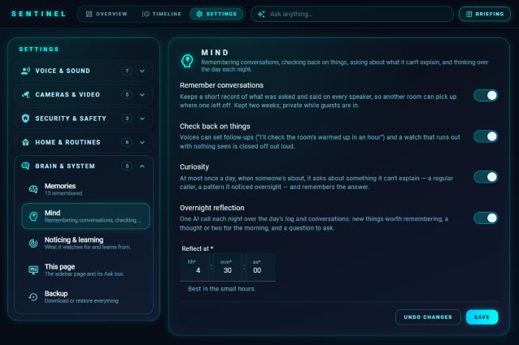
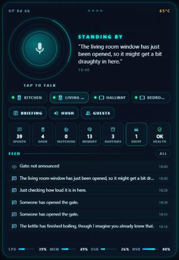

# Sentient

**An evolving AI brain for Home Assistant.**

Sentient gives your home one shared brain. Every voice assistant and automation in the house uses the same memory, follows the same house rules about when and where to speak, and gets smarter the longer it runs.

It works with the AI you already have in Home Assistant (Google Gemini, OpenAI, Ollama, anything with a conversation agent). It doesn't need its own API key.

> **Status: beta.** In daily use in one house; feedback and issues very welcome. Needs Home Assistant 2025.10 or newer, a conversation agent (Google Gemini, OpenAI, Ollama…) and, for camera and background features, an AI Task entity.

## What it does today

- **Shared long-term memory.** "Remember the rabbits' hutch is by the shed." Any voice in the house can then recall it. Near-duplicates are merged rather than piling up.
- **One brain for every voice.** Tick **Sentient** under *Control Home Assistant* in any conversation agent. That agent gets the household's memories in its context, plus tools to remember, recall, forget and announce.
- **House speech rules, in one place.** `sentient.say` and the voice tools:
  - respect quiet hours, which urgent messages still break through;
  - strip words you never want used ("sir", ...);
  - drop duplicates;
  - stay quiet for a set time after chosen automations, e.g. your doorbell flow;
  - speak where people actually are. Each room gets an activity score from the last few minutes of motion, with a big boost when someone has just spoken to a speaker there. Hallways and landings can be marked as pass-through so a passer-by doesn't steal the message. By default every occupied room hears it; speakers you mark backup-only are used only when nobody is in any other speaker's room. Speakers and sensors are matched by area, and the history is rebuilt from the recorder after a restart.
- **Watches.** "Tell me when the washing machine finishes", "tell me if the bedroom goes above 24", "watch the garden until 6 and tell me if the cats go near the rabbit pen". Device watches are free; camera watches only ask your AI when that camera's own motion or object sensor fires (or a zone sensor you name), at most once a minute and up to a daily limit you set. If the AI says the picture is too dark or unclear to be sure, an optional bigger "second opinion" model is asked — only then. They survive restarts, expire on their own, and can be listed or cancelled by voice. Services: `sentient.watch`, `sentient.cancel_watch`.
- **Noticing.** Pick the things worth noticing (washing machine, windows, weather, vacuum...). When they change, free rules run first — quiet hours, hush periods, an hourly limit, ignoring jitter, batching changes together — and only then does your AI decide whether it's worth a remark, or a question that opens the mic ("It's started raining and the bedroom window's open — want me to remind you in ten minutes?").
- **House rules.** Plain sentences every voice must follow ("Never say the house is empty").
- **Ask.** `sentient.ask` asks out loud in the room people are in and listens for the answer — handy for automations like a brew offer.
- **Learning.** Every night Sentient looks at two weeks of history for the lights and switches you choose and spots routines ("the hallway light usually goes on around 5:30pm on weekdays") with plain statistics — no AI, and anything an automation already does to the minute is ignored. Voice assistants know your routines, and once per new routine, during the day when someone's home, it offers: "want me to do that for you from now on?". Say yes and it does. It also learns **links** — things people do straight after something else, like "when the back door opens after dark, the kitchen light goes on within a minute" — from doors, windows, the lights themselves and anything else you add, with an after-dark version when that's what makes it reliable. Offered the same way, and once adopted the house does it the moment the first thing happens. Anything learned that isn't really a habit can be deleted for good — the ✕ on the sidebar page, "forget that routine" to any voice assistant, or `sentient.forget_routine` — and it's never learned or offered again (a *bring back* link undoes it).
- **Visitors.** When the doorbell rings, one AI look through the door camera logs who came ("a delivery driver holding a small parcel") — quietly, unless you choose to have it announced. After a delivery it looks again and can say a parcel's been left. Add a doorstep person sensor (e.g. a Frigate zone) and it also catches the couriers who don't ring: when a visit there ends without the bell, one look checks for a parcel or post — said only when something new has appeared. Voice assistants answer "did anyone come round?" from the log.
- **Briefings.** "What's my briefing?" — you choose what's in it (time, weather, reminders, watches, routines coming up, anything open, visitors, recent remarks, system health and updates, to-do lists, calendars) on its own settings page, can turn briefings off, and can set a daily time (only spoken when someone's home and outside quiet hours). `sentient.briefing` speaks one where people are.
- **Memory upkeep.** Every Sunday night the AI merges duplicate memories and drops nonsense, never touching more than a third at once (`sentient.tidy_memories` to run it now).
- **Reminders.** "Remind me at 6 to put the oven on" — said at that time in whichever room people are in (it gets through quiet hours, because someone asked for it). Service: `sentient.remind`.
- **Spots.** "On the garden camera, the rabbit pen is a spot" — the AI finds it once and remembers where it is. Watches and looks that mention it then check only that part of the picture: sharper answers for less.
- **Look.** "What's going on in the garden?", "is there a parcel at the front door?" — one on-demand look through a camera via your AI task.
- **Motion lights.** Pick a light and its motion sensors on the Settings tab: it comes on with movement between sunset and sunrise and goes off a few minutes after it stops. Each light chooses whether quiet hours keep it off (a landing might not want that), its brightness, and a dimmer brightness for late at night (a window you set, 23:00–06:00 by default). A light someone switched on by hand is left alone, and if someone changes one the house switched on, it's theirs until it's next off. For a dim room, add a light sensor and "dark" means below a lux level instead of after sunset. Voice assistants can list them or stop one ("stop the landing light coming on with motion"), and the overview shows each one live with an on/off switch. No AI, and routines aren't learned from these lights.
- **Timeline.** One running log of what the house did and noticed — what it said (and where), what it held back and why, remarks it decided against, doorbell visitors, watches and reminders going off, motion lights, devices going offline and coming back. A Timeline tab on the sidebar page shows the last three days live, with filters, and voice assistants can answer "what happened while I was out?". An optional briefing the first time someone's up and about in the morning (once a day, in that room). A **daily digest** (on demand from the Timeline tab, or at a time you set) has your AI sum the day up in a few sentences — kept on the timeline and optionally sent to phones.
- **Phone notifications.** Pick the phones (any notify entity, e.g. the Home Assistant app) and what goes to them: urgent announcements, things held back in quiet hours, things nobody could hear, doorbell visitors and parcels, watches and reminders, house health problems. Each message at most once in ten minutes.
- **Welcome home.** Optional: when someone gets back after 20 minutes or more, a "Welcome back" in the room they're in — with a sentence or two on what's worth knowing from while they were out (visitors, things that finished, problems), written by your AI from the timeline. Never in quiet hours, hush or guest mode, no names, once for people arriving together.
- **Speaking to suit the room.** Optional speaking volume (and a quieter one for quiet hours), set on the speaker's own volume control and put back afterwards; anything playing in the same room is turned down while Sentient talks, then back up. A speaker that can hear the room (a loudness sensor on the same device — see [the ESPHome snippet](docs/SETUP.md#room-loudness-esphome)) has a one-second listen first and speaks up over a TV or a busy kitchen, learning each room's usual level as it goes.
- **Messages follow you.** Something said where nobody was about — or held back for quiet hours (a watch, a reminder, a parcel) — is passed on the next time someone walks into a room with a speaker: "Earlier: the parcel's been left by the door." Dropped after a time you set.
- **Closing loops.** Voices can set a follow-up ("I'll check the lounge has warmed up in an hour") and the house checks back and says how it went; a watch that runs out with nothing seen is closed off out loud ("no sign of the post — I've stopped keeping an eye out") rather than going quiet.
- **Remembers conversations.** What was asked and said on every speaker is kept for two weeks, so the kitchen can pick up where the bedroom left off ("what was I asking earlier?"). Only conversations that use Sentient count, and it's kept private while guests are in.
- **Curiosity.** At most once a day, in the daytime, when someone's about, it asks about something it can't explain — someone unnamed calling on the same weekday for weeks, or a question from its overnight reflection — and remembers the answer.
- **Overnight reflection.** One AI call in the small hours thinks over the day's timeline and conversations: a few new things worth remembering (never private details), a thought or two passed on when someone's up in the morning (and in the morning briefing), and a question for curiosity. A quiet day costs nothing.
- **The drive.** Draw a spot called "drive" on the camera that sees it: when the camera's motion or car sensors settle down, one AI look counts the cars and describes them. A *Drive* sensor, arrivals and departures on the timeline, and every voice can answer "is my car on the drive?".
- **Shush.** "Stop telling me about the washing machine" (or "…for tonight") — that thing isn't noticed or mentioned until the time's up or it's unshushed; a Shushed page lists them. Urgent and safety alerts always get through.
- **Safety alerts.** Smoke, carbon monoxide, gas, water-leak and tamper sensors are found automatically, and so is the alarm going off — plus anything else you add (a panic button, a freezer-too-warm sensor): said on every speaker through quiet hours, hush and guest mode, repeated twice while still on, logged and sent to phones. A test button on the settings page.
- **Routines.** Named routines — "goodnight", "good morning", "leaving" — built with Home Assistant's own action editor on the Settings page, with other ways of asking, an optional line to say, and optional checks first ("the back door is still open, the landing light is still on"). Run by voice, a button on the sidebar page or `sentient.run_routine`.
- **Backup.** Download everything Sentient has learned and been told as one file, and restore it (adding, never deleting) from the Settings page.
- **Energy.** Uses the devices already on Home Assistant's Energy dashboard: today's use compared with the same part of the day over the past week, an Energy card on the sidebar page, an optional briefing section, a voice tool ("what's using all the electricity?") and a timeline note when something uses far more than usual. Plain statistics, no AI. Can be switched off, and an optional unit rate shows today's cost.
- **Security check.** "Is the house locked up?" — doors, windows, gates and garage doors open, locks unlocked and the alarm's state, from a voice tool, a live Security card on the sidebar page, a briefing section and a routine check. Read-only: it never locks, unlocks, arms or disarms anything.
- **Left open.** Optional: a door or window open longer than you choose gets one spoken nudge (then every half hour), and when the last person goes out anything open or unlocked goes to phones.
- **Scenes by description.** "Something cosy for movie night" — voice assistants see your scenes (and what's in them) and named routines, and turn on the best fit.
- **Learning from feedback.** Shushing something, hushing the house straight after a remark, or declining or deleting a learned routine all count against that thing: it's then only mentioned when it really matters, and eventually not noticed at all, and no more routines are offered for it. It fades by half every month, unshushing takes it back, and the Shushed settings page lists what it's learned (✕ to forget).
- **Heating that learns.** From two weeks of history: how fast each thermostat warms up, the temperature it's usually set to, and when people usually get up (first movement inside, weekdays and weekends). You can also set a "warm by" time for weekdays and weekends, which wins over the learned one. The overview shows when it would need to start to be warm by then; switch on *warm up before people are up* and it does — a thermostat with its own schedule is put back on it afterwards, and one that's switched off is never switched on. Voice: "how's the heating doing?".
- **Night watch.** Learns when each door, gate and window normally opens (four weeks, weekdays and weekends). An opening at a time it never normally does, with nobody moving inside first, is an alert — timeline, phones and, if you choose, said out loud straight through quiet hours on the speakers you pick. If someone was up inside first (leaving for work), it's only noted. Unusual openings go in the morning briefing; voice: "did anything happen in the night?".
- **Weekly report.** Sunday evenings (or the THIS WEEK button on the Timeline tab, or "what have you learned this week?"): new habits, what the house does for you, what it's learned to keep quiet about, heating, night watch, new memories and how much it spoke.
- **Personality.** Calm, dry wit, warm, cheeky or composed — plus your own notes — in every remark, briefing, welcome and voice answer.
- **Offers.** Questions the house asks when someone walks in — "fancy a brew?" when the kettle hasn't been on for a while, "shall I put the heating on?" when it's below 18° — each with rooms, times, conditions and the actions for a yes. Saying no a few times makes it ask less. Set up on their own Settings page.
- **Announcements.** The doorbell, the gate: said straight away on the speakers you choose, through quiet hours if you like, skipped when a door opened just before (someone going out), with extra actions (show the camera on the tablets).
- **Alarms.** Daily, weekday or one-off alarms and appointments with a description, what to say and actions ("5:45: downstairs lights and the kettle on"), plus actions the first time someone walks into a room afterwards. Can say what's on a calendar tomorrow ("Bins tonight: recycling") and stays quiet when there's nothing. Set by voice too: "wake me at 5:45 on weekdays".
- **Camera checks.** A standing yes-or-no question for a camera when its sensor sees something — "is there a delivery van on the drive?" — to the timeline, phones and optionally out loud.
- **Light shows.** "Disco mode in the living room", "Halloween lights everywhere" — the chosen lights, a room's, or every light in the house put on a show in one of six styles (disco, party, rainbow, chill, Halloween, Christmas). With a loudness sensor (for example a voice speaker's microphone through ESPHome's `sound_level` sensor) the lively ones follow the music: louder is brighter and beats change colour. They stop by themselves after a set time and every light goes back exactly as it was, even after a restart. Motion lights leave them alone meanwhile. You choose which shows get a button on the overview. A switch, a voice tool and a `sentient.party` action.
- **Dashboard cards.** `custom:sentient-hub-card` — the house's voice at a glance with no name on it: a big tap-to-talk button that lights up while a speaker listens or talks, the last thing said, the speakers, quick buttons (briefing, hush, guests, your chosen light shows), what's next, an overnight thought or what it's wondering, the assistant's numbers (spoken, visitors, watching, memories, routines, cars on the drive, health) and a feed that fills the space left. `custom:sentient-shows-card` — just the light-show buttons, and it hides itself when none are chosen. Both load with the integration.
- **Camera security.** People followed from camera to camera ("gate → garden → shed"); an alert for someone in the garden when the gate and doors didn't open; anyone about at night with nobody up, or hanging around for minutes — with an optional AI description.
- **Did it actually happen?** When something asked for by voice doesn't happen — the thermostat's battery is flat — the house says so on the speaker that was used. Heating turned up by voice or in the app goes back after a set time.
- **Chime.** Choose whether speakers chime before Sentient talks — a setting, a `Chime` switch for automations (e.g. off at night) and a button on the sidebar page.
- **Hush and guest mode.** "Be quiet for an hour" (or the Hush switch, or `sentient.hush`) stops everything but urgent messages until the time's up. Guest mode stops remarks and routine offers and keeps personal household details out of answers. Both are switches, voice tools and buttons on the sidebar page; motion lights carry on as normal.
- **House health.** A local check every five minutes — no AI — for devices that have gone offline (every main entity unavailable, or the device's own connectivity sensor saying it's lost its connection — reported per device, after ten minutes), batteries below your threshold (one per device) and pending updates. Shown on the sidebar page, in briefings and to voice assistants; an ignore list keeps things that are meant to be off out of it.
- **Its own sidebar page.** A built-in panel (named after your persona) shows house health, learned routines (tap to let the house do one), watches and reminders (✕ to cancel, plus a quick reminder box: "20m", "1h" or "18:30"), visitors, what was said or held back and why, and where people are — plus a briefing button and an Ask box. A **Settings** tab holds every option (the same pickers as the integration's settings, grouped: voice, quiet hours and rooms, briefings, noticing and learning, door and cameras, house health, this page), a full memory manager — search, add, edit in place and forget — and **Camera spots**: pick a camera, let the AI find a named spot or drag a box on the picture yourself, see every spot outlined, and ask the camera a question about the whole picture or one spot. It's part of the integration, so it isn't an editable dashboard; turn it off in the settings if you don't want it.
- **Memory manager.** Settings → Sentient → Configure → *Memories*: see everything the house remembers, edit, forget or add by hand.
- **Room awareness.** The voice assistant is told which room the person talking to it is in, and a *Likely room* sensor shows where Sentient thinks people are (with every room's score).
- **Sensors.** `sensor.<name>_memories` (with the list), `sensor.<name>_last_spoken` (with a log of what was said or held back and why), `sensor.<name>_drive` (cars on the drive) and `sensor.<name>_mind` (conversations today, with overnight thoughts, questions and follow-ups as attributes).

## Screenshots

| Sidebar page | Hub card |
|---|---|
|  |  |

## Install

1. HACS → ⋮ → *Custom repositories* → add this repo's URL as an **Integration** (or use the button above).
2. Install **Sentient**, then restart Home Assistant.
3. *Settings → Devices & services → Add integration → Sentient*. Give it a name, pick your speakers and set quiet hours.
4. *Settings → Voice assistants →* your agent → *Control Home Assistant* → tick **Sentient** as well as **Assist**.

The [setup guide](docs/SETUP.md) walks through the rest: an AI Task entity for camera and background jobs, rooms and motion sensors, the dashboard cards, camera spots, and the ESPHome loudness sensor for light shows and speaking up in a noisy room.

## Services

| Service | What it does |
|---|---|
| `sentient.say` | Speak through the house. `priority`: `low` never interrupts, `urgent` ignores quiet hours. `speaker`: a room name, speaker name or entity id; leave empty to follow the person. Returns what happened. |
| `sentient.ask` | Ask out loud and open the mic for the answer. |
| `sentient.remember` / `sentient.forget` | Add or remove a memory. |
| `sentient.watch` / `sentient.cancel_watch` / `sentient.remind` | Watches and spoken reminders. |
| `sentient.briefing` | Speak a briefing, or return its facts. |
| `sentient.run_routine` | Run a named routine. |
| `sentient.hush` | Stop everything but urgent messages for a while. |
| `sentient.learn` / `sentient.adopt_routine` / `sentient.forget_routine` | Re-learn now; let the house do a learned routine; delete one for good. |
| `sentient.weekly_report` / `sentient.tidy_memories` | The weekly report; tidy memories now. |
| `sentient.party` | Start or stop a light show. |
| `sentient.follow_up` | Check back on something later and say how it went. |
| `sentient.reflect` | Think over the last day now, as it does overnight. |
| `sentient.wonder` | Add a question for curiosity, or ask the next one now. |
| `sentient.check_drive` | One look at the drive now. |

Every service is also listed, with its fields, under Developer tools → Actions.

## Roadmap

See [docs/ROADMAP.md](docs/ROADMAP.md).
