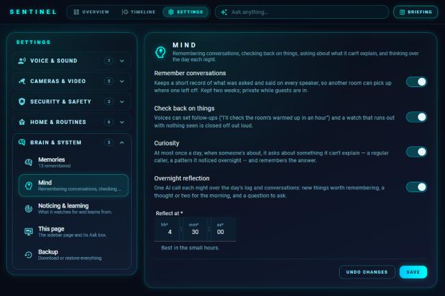
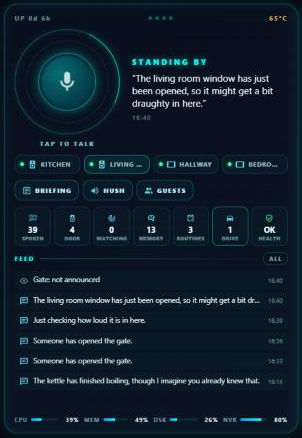

# Sentient

[Résumé en français](README.fr.md)

**An evolving AI brain for Home Assistant.**

Sentient gives your home one shared brain. Every voice assistant and automation in the house uses the same memory, follows the same house rules about when and where to speak, and gets smarter the longer it runs. It learns your habits, can say why it did or said anything, lets you choose how much it does by itself, and keeps a record of what it sends to AI services.

It works with the AI you already have in Home Assistant (Google Gemini, OpenAI, Ollama, anything with a conversation agent). It doesn't need its own API key.

> **Stable, in the Home Assistant Marketplace (formerly HACS), and in daily use.** Needs Home Assistant 2025.10 or newer, a conversation agent (Google Gemini, OpenAI, Ollama…) and, for camera and background features, an AI Task entity. Issues and ideas are very welcome.

## Principles

- **Your house, your settings.** Nothing about a particular house is built in. Names, rooms, times and devices come from your setup.
- **Cheap by design.** Plain rules run before any AI call, and Sentient never polls an AI on a timer when an event will do. Every AI call it makes on its own is counted, can be capped per day, and falls back to plain rules.
- **You choose.** Every optional feature has its own switch in Settings. Switching one off stops its work and hides its page or card. What was learned or saved is kept unless the setting says otherwise.
- **Safe by default.** Safety alerts always get through. Text it reads from the web, documents or cameras can't make it act, and it never locks, unlocks, arms or disarms anything on its own.

## Install

1. *Settings → Marketplace*, search for **Sentient** and install it (or use the button above). It's in the Marketplace catalogue, so there's nothing to add by link. On Home Assistant 2026.11 and later, a first install opens its set-up straight away; updates show under *Settings → Updates* and need a restart.
2. On Home Assistant 2025.10–2026.10 it's the same through HACS: search for **Sentient**, download it, then restart Home Assistant.
3. *Settings → Devices & services → Add integration → Sentient*. Give it a name, pick your speakers and set quiet hours.
4. *Settings → Voice assistants →* your agent → *Control Home Assistant* → tick **Sentient** as well as **Assist**.

The [setup guide](docs/SETUP.md) walks through the rest: an AI Task entity for camera and background jobs, rooms and motion sensors, the dashboard cards, camera spots, and the ESPHome loudness sensor for light shows and speaking up in a noisy room. The ten-step **set-up wizard** on the sidebar page fills things in from your house and never over anything you've already chosen, and the **Setup doctor** (*Settings → Brain & system*) checks the AI agent, voice pipeline, speakers, text-to-speech, cameras, Alexa skill and folders and says what to fix. It changes nothing and uses no AI.

## What it does

### One brain for every voice
- **One brain, every assistant.** Tick **Sentient** under *Control Home Assistant* in any conversation agent. It gets the household's memories in its context, plus tools to remember, recall, forget and announce.
- **Shared long-term memory.** "Remember the rabbits' hutch is by the shed." Any voice in the house can recall it. Near-duplicates are merged, dated memories expire, newer facts replace older ones, and memories link to devices, rooms and people. Pin a memory to keep it always in context; the rest are chosen by what was asked. A memory manager (*Settings → Sentient → Configure → Memories*, and on the sidebar page) lets you search, add, edit and forget, and a check-up on the Mind tab shows memories that disagree or repeat, side by side.
- **Remembers conversations.** What was asked and said on every speaker is kept for two weeks, so the kitchen can pick up where the bedroom left off. It's kept private while guests are in.
- **Room awareness.** The voice knows which room the person talking to it is in, and a *Likely room* sensor shows where Sentient thinks people are.
- **Personality.** Calm, dry wit, warm, cheeky or composed, plus your own notes, in every remark, briefing and answer. A "say it differently" button (shorter, plainer, less cheeky, or your own words) is followed everywhere it speaks.
- **Speaks your language (optional).** Pick Home Assistant's language or an override. Sentient says its built-in sentences in it, prepares common phrases with your existing AI and keeps them for next time, and directs AI replies into that language. Urgent alerts never wait for a translation, and generated phrases never grant permission. Your speech recognition and TTS must support the language. [Setup and limits](docs/LANGUAGE_AND_RECOVERY.md)

### Conversation
- **Talks like a conversation (optional).** Keep a topic open with "let's talk" and end it with "that's all". Connected follow-ups ("why?", "what about the kitchen?"), short follow-ups after a fresh wake word, and specific questions when a request could mean several devices ("which light, 1 or 2?"). Selection is never action approval. [Follow-ups](docs/CONNECTED_FOLLOWUPS.md), [short follow-ups](docs/RECENT_FOLLOWUPS.md), [clarification](docs/SPECIFIC_CLARIFICATION.md)
- **Honest about what happened.** Partly-done requests name the devices that did and didn't change. "That didn't work" checks fresh states and offers only what was never sent. A request it can't confirm is reported as unconfirmed, not failed. [Recovery](docs/ACTION_RECOVERY.md)
- **Why did that happen?** Ask "why did you say that?" or "who turned the heating up?" and it says when, who or what did it (a person in the app, an automation, the house or the device itself) and the reason it noted at the time, with no extra AI call. [Explanations](docs/BEHAVIOUR_EXPLANATIONS.md)
- **Knows the house right now.** Conversations get a small snapshot of the relevant live readings and recent changes (only what's exposed to Assist, private rooms kept private), plus the last hour and where there's been movement. [Details](docs/CURRENT_HOUSE_CONTEXT.md)
- **Looks again (optional, on).** A device changed through guarded control that hadn't reported back by the reply is checked once more 20 seconds later, so "did that work?" is answered from what it says now. Nothing is sent again.
- **Guarded voice control (optional).** A dedicated **Sentient guarded** API for enforced separate-turn confirmation, explicit device control and cautious undo of recent light changes. It needs a specific agent and pipeline setup. [Setup and limits](docs/VOICE_CONTROL.md)
- **Answers without the AI (optional, on).** When the AI agent fails, "is the house locked up?", "when's my next alarm?" and "did anyone come round?" are answered straight from the house before the backup agent is tried. Only questions, only what the person may see; in guest mode only the security question.
- **Voice backup.** A conversation agent called "<name> With backup": point your Assist pipeline at it and every request still goes to your AI agent, but if the AI errors or is down, eligible requests go to a backup agent (Home Assistant's own by default) so lights, heating and timers still work. Failures show in the self-check and on the timeline.
- **Understands how people talk (optional, on).** Everyday sign-offs ("cheers", "perfect, thanks", "that'll do") end a conversation when nothing specific is waiting for an answer; "sorry, I meant…", "wrong light" and "not the lamp, the ceiling light" are corrections; "on another note…" starts a fresh subject with no devices carried over. No AI. Part of conversation sessions.
- **Learning from corrections.** "No, I meant the lamp": the voice puts it right and saves one short lesson that every voice in every room then knows.
- **Voice recognition (experimental).** With the separate [Sentient Voice Recognition](https://github.com/conahmorgan2304/sentient-voice-recognition#ask-sentient-who-is-speaking) add-on running, the assistants can know which saved person is speaking. It is a good guess, not proof, and is never used to allow anything that asks for confirmation. Optionally, each person's memories stay theirs: a matched voice gets their own ("Alex: likes tea") and never anyone else's personal ones, and a voice it can't match gets none. It works best with one voice per request close to the microphone, and Echos can't do it. See [Voice recognition](#voice-recognition-setup) below.

### Speaking, rooms and quiet
- **House speech rules, in one place.** `sentient.say` and the voice tools respect quiet hours (urgent messages still break through), strip words you never want used, drop duplicates, stay quiet after chosen automations, and speak where people actually are. Each room gets an activity score from recent motion. Hallways can be marked pass-through, and backup-only speakers are used only when nobody is in any other speaker's room.
- **Any speaker.** Assist voice speakers, Echos (through Alexa Media Player, with Alexa's own chime) and any media player through a TTS voice you choose. The same rules apply everywhere. [Alexa setup](docs/ALEXA.md)
- **Speaking to suit the room.** Optional volume (and a quieter one for quiet hours), put back afterwards, with anything playing in the room turned down while it talks. A speaker that can hear the room speaks up over a TV or a busy kitchen. [ESPHome snippet](docs/SETUP.md#room-loudness-esphome)
- **Messages follow you.** Something said where nobody was about, or held back for quiet hours, is passed on the next time someone walks into a room with a speaker.
- **Hush, shush and guest mode.** "Be quiet for an hour" stops everything but urgent messages. "Stop telling me about the washing machine" silences just that. Guest mode stops remarks and offers and keeps personal details out of answers. Safety alerts always get through.
- **Stay quiet while busy.** Pick a meeting calendar, a Focus switch or a phone's Do Not Disturb sensor and speech that can wait is held back.
- **Learning from feedback.** A thumbs down on anything it said counts against what the remark was about; three and it stops saying that kind. A thumbs up is kept as an example. Shushing, hushing straight after a remark and declining a routine all count too, and it fades by half every month. Never affects safety alerts, alarms or the doorbell.
- **Chime, delivery and recovery.** Choose whether speakers chime first. Each speaker's delivery shows its stages and timings with an optional failure notification. [Delivery](docs/VOICE_DELIVERY.md)

### Learning your home
- **The house ledger.** Every change to every device is kept with what caused it: a person, a voice request, an automation, Sentient itself, or nothing in Home Assistant (the device, its own app, or someone at it). Ask "when did the heating go off, and why?" or "what changed while I was out?". A cloud device that reports a change a few minutes late is still credited to whoever asked. Kept 90 days in Sentient's own database, then summarised by day.
- **Expectations.** It learns what's usual at each hour, on weekdays and at weekends (starting from three weeks of history), scores every change from usual to very unusual, and shows on the Mind tab how much of each day it expected. When an important device changes by itself at an odd time, it says so once, and links repeats: "the third time this week, always around 11am".
- **Beliefs it tests.** Each night it forms claims from what keeps happening, tests them against the day just gone, asks about one that holds and drops ones that don't. It also learns from reactions: something it switched that you put straight back counts against doing it again.
- **A year of memory.** Facts, conversations and the timeline are searchable for a year, and identical background AI jobs reuse a recent answer instead of another call.
- **Names said right.** "Siobhan is pronounced Shivawn" (a memory, or Settings → Voice) changes what the speakers say, while text keeps the real spelling.
- **Routines and links.** Every night it looks at two weeks of history for the lights and switches you choose and spots routines ("the hallway light usually goes on around 5:30pm on weekdays") with plain statistics, no AI. It also learns links, such as "when the back door opens after dark, the kitchen light goes on". Routines that follow sunset or getting up move with the seasons, things done together are offered as one, and once per new routine it asks "want me to do that for you from now on?". Say yes and it does. Anything learned can be deleted for good. Lights that movement sensors flick on and off all day are ignored.
- **Inner life.** It notices when you undo something the house did and hands back a routine you keep undoing, notes an unusual day (nobody up when someone usually is), and guesses which room you go to next and keeps score. The Mind tab shows short first-person notes of what it's thinking.
- **Asleep or awake.** The house knows when everyone has gone to bed and when someone's up, learns the usual bedtime and getting-up time, and can run bedtime and morning actions. Sensors that are on most of the day, or that you choose, are ignored.
- **Heating that learns.** How fast each thermostat warms up, the temperature it's usually set to, and when people get up. A heating schedule with any number of on/off periods a day, chosen heaters and days, edited on the House tab, plus a suggested schedule built from what it has learned. Switch on *warm up before people are up* and it pre-heats. A heating you asked for by voice goes back after a set time.
- **Appliances and maintenance.** Learns how long the washing machine, dryer, dishwasher or robot vacuum normally runs and says when one has finished or may be stuck. A Maintenance page counts how long things actually run, so "the purifier filter is due" comes at the right time.
- **Curiosity and reflection.** At most once a day it asks about something it can't explain. One AI call overnight thinks over the day, files a few things worth remembering (never private details) and passes on a thought in the morning. A quiet day costs nothing.
- **A look at tomorrow.** Each evening, one AI look at tomorrow's calendars, weather, alarms and reminders, with a heads-up only if there's something to do tonight.
- **Weekly report.** New habits, what the house does for you, what it has learned to keep quiet about, heating, night watch, battery forecasts and how much it spoke.

### Cameras and security
- **Live view and linked events.** The Security tab has a Cameras list (each camera, whether it's recording, detections today), a live view that follows whichever camera last saw something, and a timeline of linked events (each camera a lane, sightings joined when they're one incident, tap for the snapshot and clip). Cameras that show a black picture, such as some Nest and Wyze cameras, switch to Home Assistant's own player by themselves.
- **Weighs alerts before saying them (optional, off).** Before a camera-security alert is said, it looks at the alarm, whether everyone is out, an entry door that opened just before, indoor movement, Frigate events and repeats. Someone probably going out, or the same camera again within half an hour, is kept quiet; the alert still goes on the timeline and to phones with the reasons, and the alarm set or everyone out is always said.
- **Camera security.** People followed from camera to camera ("gate → garden → shed"), alerts for someone in the garden when no gate or door opened, and anyone about at night with nobody up. Parked vehicles are kept out of incidents. Optionally linked to Frigate events (see below).
- **Spots.** "On the garden camera, the rabbit pen is a spot": the AI finds it once and remembers. Watches and looks that mention it then check only that part of the picture. Draw a shape to leave out what's next to it.
- **Look, watches and checks.** "What's going on in the garden?" is one on-demand look. "Watch the garden until 6 and tell me if the cats go near the rabbit pen" only asks the AI when that camera's own sensor fires, up to a daily limit. A standing yes-or-no question for a camera ("is there a delivery van on the drive?") goes to the timeline and phones.
- **Visitors.** When the doorbell rings, one look through the door camera logs who came, and again after a delivery. A doorstep sensor catches couriers who don't ring. "Did anyone come round?" is answered from the log.
- **The drive.** Draw a spot called "drive": one AI look counts and describes the cars, with arrivals and departures on the timeline and a *Drive* sensor.
- **Night watch.** Learns when each door, gate and window normally opens. An opening at a time it never normally does, with nobody moving inside first, is an alert.
- **Safety alerts.** Smoke, carbon monoxide, gas, water-leak and tamper sensors and the alarm going off are found automatically. They're said on every speaker through quiet hours, hush and guest mode, repeated while still on, logged and sent to phones.
- **Security check and left open.** "Is the house locked up?" covers doors, windows, gates, garage doors, locks and the alarm. It never changes anything. Optionally, a door left open gets a nudge, and when the last person goes out anything open goes to phones.
- **Clips, faces and cars (optional).** Frigate's event clip watched by your AI ("left a parcel and went"), names from Frigate's face recognition when asked (never announced or guessed), and household cars named from the look at the drive.
- **Watchdog.** Plain rules for a camera whose picture has frozen, an appliance taking longer and longer, a battery draining faster, a device that keeps dropping offline, and two automations fighting over a light.

### Around the house
- **Motion lights.** Pick a light and its motion sensors: it comes on with movement between sunset and sunrise (or below a lux level) and goes off after it stops. A light switched on by hand is left alone. No AI.
- **Auto-off.** Things switched off by themselves once they've been on a while, or once a room's motion sensors have seen nobody. It learns: a light switched straight back on makes that room wait longer.
- **Alarms and reminders.** Daily, weekday or one-off alarms with what to say and actions ("wake me at 5:45 on weekdays"), and "remind me at 6 to put the oven on", which gets through quiet hours.
- **Voice routines and automated routines.** Named routines ("goodnight", "leaving") built with Home Assistant's own action editor, with other ways of asking, optional checks first and details like `{{ rooms }}`. Automated routines are things the house does by itself at a set time with nothing said.
- **Rules (optional).** "When the back door opens after dark, put the kitchen light on dim", made on the Rules page or by voice, read back and only saved after a yes. Alarm and lock actions are blocked, and so are scripts, scenes, Sentient routines, device actions and templated service names, because their effects can't be checked here.
- **Offers and announcements.** Questions the house asks when someone walks in ("fancy a brew?"), which it asks less after a few noes, and the doorbell or gate said straight away on the speakers you choose.
- **Energy.** Today's use compared with the same part of the day over the past week, from the devices on Home Assistant's Energy dashboard. With a time-of-use tariff it can nudge you to use a delay start when electricity is cheapest. Plain statistics.
- **Light shows.** "Disco mode in the living room": six styles that can follow the music with a loudness sensor, then every light goes back exactly as it was. `sentient.party`, a voice tool and buttons.
- **Scenes by description.** "Something cosy for movie night" picks the best-fitting scene.
- **The world outside.** Chosen sensors (electricity price, weather warnings, parcels) go into the briefing; a parcel "out for delivery" means the door is watched all day. Rain warnings, bins the evening before collection, and animals outside (a hutch or coop that is too cold or hot, with a frost warning the evening before).
- **Music (optional).** With Music Assistant, "play something calm in the kitchen" plays from your own library.
- **Trust, rooms and holiday mode.** Choose per kind of device whether the house just does it, says so first or asks. Rooms can be private (no personal memories), gentler, or have their own volume and quiet time. Holiday mode keeps the house quiet, sends things to phones, runs away lights and turns chosen heating down.

### Every day
- **Extra skills (each off until switched on).** Official weather and flood warnings for your own country; "any new email?" through Home Assistant's IMAP integration (read-only); calendar clashes; "is my setup secure?"; and automations from plain English, checked against your house, read back, and saved only after your yes in the next turn (signed-in admins; never locks, alarms, garages or gates).
- **Briefings.** "What's my briefing?" with the sections you choose, an optional daily time, spoken only when someone's home and outside quiet hours, plus an optional first-up morning briefing and a daily digest.
- **Welcome home.** After a set time away, a "Welcome back" in the room they're in with a line on what happened, written by your AI from the timeline. Never in quiet hours, hush or guest mode.
- **Timeline.** One running log of what the house did and noticed: what it said and where, what it held back and why, visitors, watches, motion lights and devices going offline. Ask "what happened while I was out?".
- **Phone notifications.** Pick the phones and what goes to them. Tapping one opens that moment on the timeline, and buttons (the door camera, snooze a reminder) work through the companion app. Questions can be answered from your phone when nobody's near a speaker.
- **Books and stories (optional).** "Read Princess Scarlet", "carry on with the book", "pause", "next chapter": DRM-free .epub or .txt ebooks and your own stories are read aloud until stopped or paused, and audiobooks (.mp3, .m4b, a folder of parts) are played. Each speaker keeps its own place. There's a sleep timer, "go back a bit", "what happened last time?", and an optional **reading voice** (Gemini, ElevenLabs, Home Assistant Cloud…) just for stories. The next part is made while this one is read, so there are no gaps. `sentient.stop_reading` stops it without a voice. Echos read one passage per request and can't play audiobooks.
- **Recipes and cooking mode (optional).** From a media folder, Mealie or Tandoor: "let's make the lasagne", then "next", "repeat that", "go to step 5", "make it for 6" and "add the ingredients to the shopping list".
- **Manuals and goals (optional).** "How do I descale the coffee machine?" answered from your PDF manuals, with the page it's on. Each manual is read page by page once, on your own machine, so a question sends the AI only the few pages that matter rather than the whole PDF, and a manual is found by what it says even when its file name doesn't match. When the AI is down the closest passage is read out with its page. Scanned PDFs are still read whole by the AI. Goals like "use less electricity this month" are tracked from the house's own history.
- **Story games (optional).** Voice-led games with your assistants as game master, each with a saved memory of its own (where the players are, what they carry, what they found and chose) that carries on between sessions and assistants. Start from the **Escape the house** template and fill in your own game master, players, rooms and helpers (they default to your assistant's name and Home Assistant areas), write your own, or ask by voice. The game's memory is shown to a voice only while it is played. Settings → Story games.

### Pages, cards and sensors
- **The sidebar page.** A built-in panel named after your persona: Overview (today, coming up, the day so far), House (rooms, heating, energy, appliances, routines), Mind (what it's thinking, questions, memory check-up), Security, Timeline and Settings. The lists you use day to day sit on their own tab, as rows in the column they belong with, and open in a sheet over the page: alarms, automated and voice routines, motion lights, auto-off, maintenance and story games on House; memories, shushed, how it's used and what leaves the house on Mind; camera spots and camera checks on Security. Settings opens on a front page of its groups and keeps every switch and set-up page in nine short menus, with search, and the longest pages fold into sections. It fits a tablet screen.
- **Dashboard cards.** `custom:sentient-hub-card` is the house's voice at a glance (tap to talk, last thing said, speakers, quick buttons, what's next). `custom:sentient-shows-card` is just the light-show buttons. Both load with the integration.
- **Tablet screen.** `custom:sentient-screen-card` turns a wall tablet into the house's screen: whatever it says that matters also appears as a card, with that camera live when there is one, plus a morning card and the house at a glance. Can be turned off. Automations can put their own cards up with `sentient.show_on_screen`.
- **Sensors.** `sensor.<name>_memories`, `sensor.<name>_last_spoken` (what was said or held back and why), `sensor.<name>_drive`, `sensor.<name>_mind`, a *Likely room* sensor and a *House* sensor.

### Reliability, privacy and cost
- **House health and self-check.** A local check every five minutes, no AI, for offline devices, low batteries, pending updates, settings that point at things that no longer exist, and Sentient's own parts: the AI not answering, today's limit used up, a speaker that failed, stuck motion sensors. An optional overnight self-test asks the voice a few everyday questions and checks the answers.
- **AI meter and daily cap.** Every AI call Sentient makes on its own is counted by what it was for. At the daily limit it stops calling the AI until midnight and falls back to plain rules. Questions people ask are always answered. The drive, noticing and camera checks can each have their own allowance, and cameras compare a tiny picture first.
- **Privacy.** *Brain & system → What leaves the house* shows every AI call and web search it makes by itself (never the content), with a button to forget the last 48 hours. Face names stay out unless Faces is on. Unlocking by voice is its own switch. An optional setting limits the Sentient page to administrators, the light show and memory management need administrator permission, and diagnostics hide personal settings.
- **Backup.** Download everything Sentient has learned and been told as one file, restore it (adding, never deleting), save a weekly backup in the config folder, or export a readable copy.
- **Keeping it simple.** *How it's used* shows which optional features you use and which are on but never used. New installs start with a simpler settings page, and a short card after each update says what's new. An optional update checker looks for new releases every six hours; installing and restarting stay manual. [Updates](docs/UPDATES.md)
- **Reviewed.** Releases come with review notes in [docs](docs/), starting with [the full review](docs/FULL_REVIEW_0988.md).

## Voice recognition setup

For a local reply to **"Who's speaking?"**, set up the separate [Sentient Voice Recognition integration](https://github.com/conahmorgan2304/sentient-voice-recognition#ask-sentient-who-is-speaking) and enable **Let Sentient identify speakers locally** in its settings. Then Settings → **Voice recognition** in Sentient lets the assistants use the speaker's name (and, if you choose, treat voices it can't match like a guest). The tab shows why a voice was or wasn't matched, with its score, lets you record a voice from any speaker and tune the match level. Until the add-on is installed, that tab only shows where to get it. Switch it off and the speaker is never looked up.

## Screenshots

| Sidebar page — settings | Hub card |
|---|---|
|  |  |

## Services

| Service | What it does |
|---|---|
| `sentient.say` | Speak through the house. `priority`: `low` never interrupts, `urgent` ignores quiet hours. `speaker`: a room name, speaker name or entity id; leave empty to follow the person. Returns what happened. |
| `sentient.ask` | Ask out loud and open the mic for the answer. |
| `sentient.remember` / `sentient.forget` | Add or remove a memory. |
| `sentient.watch` / `sentient.cancel_watch` / `sentient.remind` | Watches and spoken reminders. |
| `sentient.briefing` | Speak a briefing, or return its facts. |
| `sentient.run_routine` | Run a named routine. |
| `sentient.hush` | Stop everything but urgent messages for a while. |
| `sentient.learn` / `sentient.adopt_routine` / `sentient.forget_routine` | Re-learn now; let the house do a learned routine; delete one for good. |
| `sentient.weekly_report` / `sentient.tidy_memories` | The weekly report; tidy memories now. |
| `sentient.party` | Start or stop a light show. |
| `sentient.follow_up` | Check back on something later and say how it went. |
| `sentient.reflect` | Think over the last day now, as it does overnight. |
| `sentient.wonder` | Add a question for curiosity, or ask the next one now. |
| `sentient.check_drive` | One look at the drive now. |
| `sentient.game` | Start a story game, or put the current one away (its memory is kept). |
| `sentient.stop_reading` | Stop a story or book being read aloud and keep the place. |

Every service is also listed, with its fields, under Developer tools → Actions.

## Checking a new version against your own house

Every change is checked in three ways before it's released:

- **Page checks.** Every tab, Settings page and editor of the Sentient page is opened in a browser against answers recorded from the real integration; any error fails the build.
- **Integration audit.** A module nothing loads, a setting nothing reads or a button calling a command that doesn't exist fails the build.
- **Replay.** Settings → Setup doctor → **DOWNLOAD THE LAST DAY** saves the last 24 hours of your house (every change and its cause, from the house ledger) and what Sentient decided. `python scripts/replay.py bench sentient-day-*.json --old v1.5.14` runs that day through two versions on a simulated clock — nothing spoken, no device touched, no AI — and compares what they would have said, sent to phones, held back and switched. Bugs found in a real house become regression days in `tests/fixtures/replay/` (made-up houses), replayed on every build.

## Roadmap and release notes

See [docs/ROADMAP.md](docs/ROADMAP.md) for what has landed and what's planned, and the GitHub releases for each version.

### Optional security event continuity (0.98.12)

In **Settings → Camera security**, enable **Link security alerts to Frigate events**, **Keep the security event in the conversation** and/or **Record feedback on camera events**. Events come from Frigate MQTT (with bounded local REST matching when needed), on configured cameras only. A unique camera/time match remains a candidate link. The Mind page shows event evidence and admin feedback controls; voice follow-ups can select an event, ask why it alerted, or fetch current sensor reports without treating an old clip as live evidence. Corrections stay attached to the event and never change Frigate thresholds automatically.

In **Settings → Event clips**, **Reuse matching clip analyses** shares compatible generic reviews of the same finished event between the two clip services. It checks provider, footage coverage and identity profile; custom questions and multi-event reviews remain separate. All four additions are off by default. Event metadata, summaries and feedback retain at most 200 records for seven days; shared answers retain at most 100 entries for six hours in memory. Turning features off hides their controls and clears conversation references/shared answers. Retained event records expire or can be erased using **Forget recent data**. Existing event-clip/clip-watch settings still control AI reviews.

### 1.5.12 — Optional coordination, local document intelligence and measurable evaluation

The features added in [PR #148](https://github.com/conahmorgan2304/sentient/pull/148) are opt-in where they can affect household actions, spending or privacy.

- **Motion lights and Auto-off:** a motion rule can hold its own turn-on for two minutes after a guarded voice-off command; Auto-off can optionally hold a routine turn-off for two minutes after guarded voice-on. Both switches are **off by default**, affect only reversible light/switch actions and never control locks, alarms or heating. For motion lights, edit the individual rule. For Auto-off, use Settings → Safety & security.
- **Incident reviews:** administrators can label retained security episodes from event details. Sentient reports aggregate stage agreement; household reviews are not independent proof, no detector settings or alert policies change, and guest users do not receive private review metrics.
- **Semantic memory:** Settings → Memory & learning offers a default-off connection to a locally running Ollama-compatible `/api/embed` service. Enter a numeric private LAN/loopback URL and an already-installed embedding model. Only the existing permitted search results are sent to that host, using a numeric RFC1918 or loopback IP rather than a DNS name; calls time out after two seconds and normal lexical search remains the fallback. **Nothing is downloaded automatically.** Enabling this explicitly shares candidate memory text with that local service.
- **Document OCR:** Settings → Manuals & documents offers optional local Tesseract OCR for image-only PDF pages. It is **off by default**; the Tesseract executable must already be installed on the Home Assistant host. Standard HA OS may not include it. The OCR path has per-image and per-file limits, sends nothing to cloud OCR and reindexes when the local OCR mode changes.
- **Background AI routing:** Settings → Doorbell & AI looks offers optional selection of a cheaper alternative `ai_task` entity for eligible text-only background jobs. The same settings screen includes administrator-only **CHECK COUNTS** and **TEST PRIMARY/ALTERNATIVE ONCE** calibration controls. Every test asks for confirmation, can cost money, uses a fixed generic prompt with no household content, counts toward your daily AI budget, and is rate-limited to once per 30 seconds. It never starts an automatic calibration loop. It requires user-entered price estimates and at least 20 observed calls for both providers, with a service reliability/latency check. It never automatically redirects vision, structured-output or explicitly targeted requests. Cost estimates are **not verified bills** and successful calls do **not** prove response accuracy.
- **Measured heating usage:** in Heating settings choose a dedicated cumulative kWh sensor, a comparison date and optionally a price per kWh. The Heating page can compare matched recorded weekdays before and after that date. The result is **observed usage change only**, not proven savings caused by Sentient. Without sufficient Recorder history, it reports insufficient data.
- **Pages:** switch on **Rearrange the Sentient page** in Settings (off by default). Administrators then get EDIT LAYOUT to move, drag, hide, restore and reset built-in cards. Disabling restores the original page arrangement without deleting saved preferences. Arbitrary HACS card execution is not enabled.

**Live verification still required:** Nest streaming on your actual devices, multiple enrolled voice users, installed local OCR/embedding services, realistic AI billing, representative independent incident reviews and Home Assistant energy history. See `docs/COGNITIVE_COORDINATION_PHASE2.md` for test gates and limitations.
